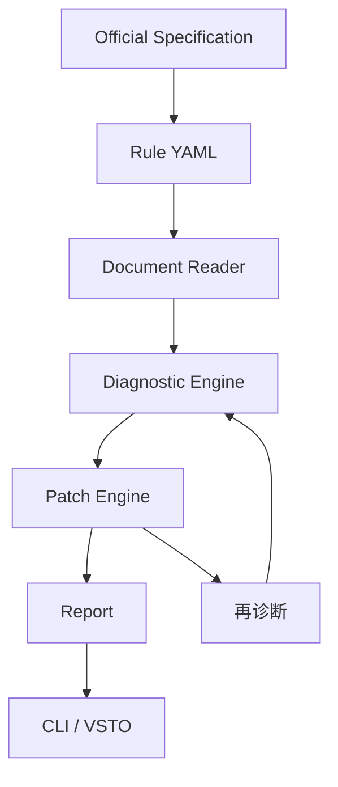

# 架构

独立 Core 读取 OOXML，有效格式需要处理文档默认值、主题、样式继承及直接格式；段落与节分别定位，不能假设全文只有一个节。
规则先核验再批准；字体需区分东亚/拉丁字体，字号单位 pt，页边距 cm，行距区分倍数、固定/最小值（当前 schema 仅 multiple/pt；额外模式须 RFC）。
先实现四类规则：字体、字号、行距、页边距。后续规则分阶段扩展。
auto：定位与前置条件明确、安全可重复；suggest：有歧义或依赖作者判断；manual：无法可靠自动修复。
CLI 与 Word 插件采用不同的写入边界：CLI 对输入 DOCX 生成新输出文件，保留未改动部件并对输出复诊；VSTO 从当前 Word 内存状态建立快照，通过协议调用引擎定位候选项，再由作者确认后直接修改当前打开的文档。插件不自动保存，保存由作者决定；单项、批量和整篇排版各自保留撤销记录。
结构排版先由规则分类器提取候选段落角色与置信度，作者在整篇大纲确认界面中核对角色、范围和规范配置，并明确勾选后才写入。未确认、低置信度、覆盖范围之外及复杂结构均保留原格式。Word 大纲流程当前不调用 AI；可选 Ollama 适配仅用于 CLI 的结构候选建议，不能代替作者确认，也不保证规范结论。
已实现的 Word 流程包括文字格式、题注及部分图表/表格布局检查与修复、问题列表定位、批量修复/撤销、单项撤销和整篇角色排版。覆盖边界见对应验收文档；尤其不能据此声称自动重排任意表格内部、复杂图形、页眉页脚、目录域或所有论文规则。对未覆盖结构应报告或跳过，不能推断为合规。
CLI 仍是 Core 规则与 OOXML 能力的主要自动化验证入口；VSTO 使用 Windows Word/.NET Framework，通过进程协议调用引擎，Word 对象模型写入由插件执行。零诊断仅表示已覆盖规则未发现问题，不是整篇论文合规证明。
