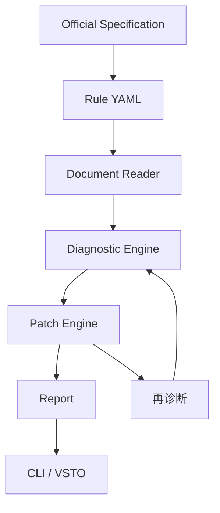

# 架构

独立 Core 读取 OOXML，有效格式需要处理文档默认值、主题、样式继承及直接格式；段落与节分别定位，不能假设全文只有一个节。
规则先核验再批准；字体需区分东亚/拉丁字体，字号单位 pt，页边距 cm，行距区分倍数、固定/最小值（当前 schema 仅 multiple/pt；额外模式须 RFC）。
先实现四类规则：字体、字号、行距、页边距。后续规则分阶段扩展。
auto：定位与前置条件明确、安全可重复；suggest：有歧义或依赖作者判断；manual：无法可靠自动修复。
补丁写新文件，保留未修改部件，再检测输出。二次 diagnostic=0、patch=0 是语义幂等；ZIP 元数据会变化，整个 docx 哈希无效。
当前只有包加载验证，没有正式诊断、补丁或合规报告。标题、目录、编号、引用属于后续范围。
CLI 是第一验证入口。VSTO 使用 Windows Word/.NET Framework，通过进程协议调用引擎；UI 只展示、定位、确认和发起流程。
