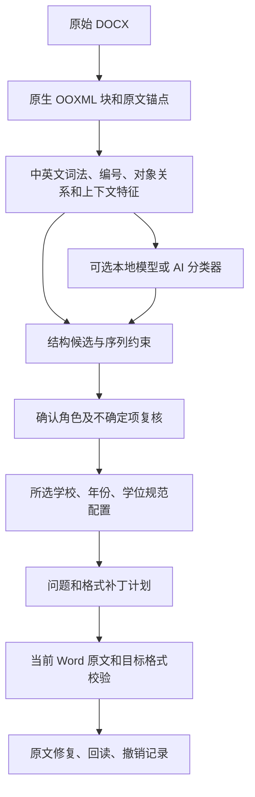

# 无样式论文结构识别：开源选型与实施路线

调研日期：2026-10-26。范围：中文、英文和中英混排 DOCX 的论文结构识别，以及识别结果如何安全映射回当前 Word 文档。本文是源码与官方资料调研和本项目的设计建议，未运行上游解析器、下载模型或上传论文；上游的公开性能数字不等于本插件的验收结果。

## 选型结论

主线采用“原生 OOXML 块与锚点提取 → 中英文段落角色识别 → 结构约束与用户确认 → 已审核的规范规则 → 原文范围核验后修改”。保留当前 .NET 引擎和 Word 写入通道，逐步参考 Open XML SDK 完善复杂 OOXML 读取。结构分类器可以接本地模型或显式启用的 AI 服务；模型输出段落角色和证据，格式目标仍来自版本化的南开规范配置。

Docling、Unstructured 适合作为内容模型、解析实现和对照基线；GROBID 适合借鉴学术结构标签、级联分类和训练评测方法；PaddleOCR、LayoutParser 适合作为后续渲染图像的视觉辅助。这些项目都没有提供经验证的“任意无样式中英文论文 → 南开各部分规范 → 当前 Word 精确回写”完整能力。

“无样式”需要再区分两种输入：全部使用 Normal、相同字号的 DOCX 通常仍有段落、表格和图形对象，能继续分析；如果全文连段落边界、标题词、编号和语义上下文都不足，则原作者意图有歧义。系统可以给出候选结构并允许确认，不能用一个看似确定的标签掩盖这种歧义。

## 项目比较

| 项目 | 已核对的能力 | 对无样式中英 DOCX 的适合程度 | 可回写 Word 原文的锚点 | 许可、运行资源与本项目用法 |
| --- | --- | --- | --- | --- |
| [Open XML SDK](https://github.com/dotnet/Open-XML-SDK) | .NET 的 OPC/OOXML 读取、修改和强类型标记 API；官方明确它是低层 API，并非高层语义工具 | 适合作为读取基础；段落角色和论文规范匹配需要自己实现 | 能保留原 part、元素与关系，由本项目建立稳定位置映射；不直接产生 live Word Range | [MIT](https://github.com/dotnet/Open-XML-SDK/blob/main/LICENSE)，无预训练模型。优先参考并逐步使用，适合现有 .NET 引擎 |
| [docx4j](https://github.com/plutext/docx4j) | JAXB 表示的 OpenXML 包读取、编辑、保存，覆盖图表、样式、内容控件等 | 可借鉴完整文档结构处理；没有现成的中英文论文语义分类器 | 原生对象树可供建立映射；仍须核验源文档与当前 Word 文档 | [Apache-2.0](https://github.com/plutext/docx4j/blob/VERSION_17_3_5/legals/LICENSE)，当前 README 的主线要求 Java 11+。引入 JVM 对现有 .NET 桌面插件成本较高，先借鉴源码与样例 |
| [Docling](https://github.com/docling-project/docling) | 原生 DOCX、PDF 等多格式读取，统一 DoclingDocument、层级、表格、图形和导出 | DOCX backend 使用 python-docx，标题仍使用样式名和 outlineLvl 等信号；无法据此承诺识别完全无结构标记的论文 | 已审阅 backend 有 paragraph-to-item 内存映射和内部 Ref/FineRef；这些不是本项目可直接写回的 OOXML/run/Word Range 合同 | 代码 [MIT](https://github.com/docling-project/docling/blob/main/LICENSE)，模型许可分别核对。Python 3.10+；原生 DOCX 路径与 PDF/OCR/VLM 路径的依赖不同。作为可选适配器与对照，不替换主锚点 |
| [Unstructured OSS](https://github.com/Unstructured-IO/unstructured) | DOCX 分块为 Title、NarrativeText、Table 等，附样式、页码、链接等 metadata | 先按 Word 样式，再按文本启发式，最后退回 Text；部分文本判断默认 English，中文需要专门评测和规则适配 | 输出 element、page metadata 和内部 ID 不能直接当作原文 run 坐标；空段落丢弃和编号补入还会改变输出序列/文本 | [Apache-2.0](https://github.com/Unstructured-IO/unstructured/blob/main/LICENSE.md)，Python；可只装 docx extras。借鉴分块、表格 metadata 和回退机制，不能直接将通用 Title 判定视为论文规范角色 |
| [GROBID](https://github.com/grobidOrg/grobid) | 技术/学术 PDF → TEI；整体分区、标题、正文、引用、图表题注等；级联序列标注 | 主输入是 PDF，没有原生 DOCX 回写通道。非英语可重训，不等于默认模型已覆盖中文学位论文 | 提供的是 PDF bbox 与 TEI 结构，不能作为 DOCX/Word 修改坐标 | 代码 Apache-2.0；文档 CC0、标注数据 CC-BY。当前构建需 OpenJDK 21，原生运行面向 Linux/macOS，README 不保证 Windows；默认 CRF 可用 CPU，DL 另需 Python/JEP/模型，可用 GPU。借鉴标签与训练流程，不作为首版常驻服务 |
| [PaddleOCR / PP-StructureV3](https://github.com/PaddlePaddle/PaddleOCR) | 图像/PDF 版面、文字、表格等；支持中文与英文，结构输出含图像坐标 | 对渲染后版面可有帮助；当前也有 Office 转 Markdown 和结果导出 DOCX 功能，但新导出文件不能证明保留原 DOCX 锚点 | 图像坐标和新生成 DOCX 均须经独立原文映射，不能直接驱动 Word 修改 | [Apache-2.0](https://github.com/PaddlePaddle/PaddleOCR/blob/main/LICENSE)；Paddle/Python 与所选 OCR/布局/VLM 权重，资源依模型而变。保留为可选视觉复核 |
| [LayoutParser](https://github.com/Layout-Parser/layout-parser) | 文档图像布局检测、OCR 接口和布局数据结构 | 适合图像布局实验；没有默认的无样式中文学位论文语义分类模型 | 图像区域不是 OOXML 元素或 live Range | [Apache-2.0](https://github.com/Layout-Parser/layout-parser/blob/main/LICENSE)；Python，布局模型/OCR 可选，Detectron2 模型需额外安装。作为研究基线，首版不引入 |

以上“适合程度”和选型属于本项目的工程判断。语言覆盖、解析准确率、模型权重许可、内存和延迟都应在确定版本与配置后实测，不能用上游 PDF benchmark 代替本插件的 DOCX 修复验收。

## 源码审查中影响选型的细节

Docling 的 [Word backend](https://github.com/docling-project/docling/blob/main/docling/backend/msword_backend.py) 读取 python-docx 对象，解析样式名与大纲级别；`_get_outline_level_from_style`、`_get_heading_and_level` 是明确的结构信号处理。它在 `_add_body_text_items` 中生成统一文本项，在 `paragraph_to_items` 中为批注关联保留内存映射；这可借鉴，但输出的内部引用不应直接解释成当前 Word 的修改坐标。Docling 官方支持预取模型并通过 `artifacts_path` 离线使用，远程服务需显式启用，适合参考其本地默认执行和可选服务边界。[官方高级选项](https://docling-project.github.io/docling/usage/advanced_options/)

Unstructured 的 [DOCX 分块源码](https://github.com/Unstructured-IO/unstructured/blob/main/unstructured/partition/docx.py) 在 `_classify_paragraph_to_element` 中先查样式，再解析文本；空段落不会输出，自动编号可能作为文字前缀加入。其 `_paragraph_metadata` 记录样式、页码和链接等，并未建立本项目需要的 part/paragraph/run 回写合同。[文本分类源码](https://github.com/Unstructured-IO/unstructured/blob/main/unstructured/partition/text_type.py) 的默认语言是 `eng`，包含英文词表、词性、大小写及按空格计词等启发式；因此需要增加中文样例评测，不能把“能读取中文字符串”视作“已正确区分中文标题与正文”。

GROBID 的 [官方 README](https://github.com/grobidOrg/grobid/blob/master/Readme.md) 说明它处理学术 PDF，并输出 TEI 和 PDF 坐标；默认采用 CRF，可选 Deep Learning。官方的 [工作原理](https://grobid.readthedocs.io/en/latest/Principles/) 采用分阶段的序列标注，值得借鉴“先分区、再细分角色”的设计。[训练文档](https://grobid.readthedocs.io/en/latest/Training-the-models-of-Grobid/) 明确非英语可迭代重训，并要求完整标注模型内的标签；这支持建立中文/英文的专门评测和训练集，不能直接推断默认模型在南开论文上的精度。其 [资源说明](https://github.com/grobidOrg/grobid/blob/master/doc/Introduction.md) 给出的内存数字属于具体 PDF 服务配置，不作为本机插件的资源承诺。

Open XML SDK 和 docx4j 的定位是保留/处理文件结构；它们不负责判断一段无样式文字究竟是摘要、一级标题还是正文。[Open XML SDK README](https://github.com/dotnet/Open-XML-SDK/blob/main/README.md)、[docx4j README](https://github.com/plutext/docx4j/blob/VERSION_17_3_5/README.md) 可作为原生读取和编辑实现的依据。PaddleOCR、LayoutParser 的布局能力应只参与结构候选和渲染复核，原文写入仍走同一套 OOXML/Word 锚点校验。[PaddleOCR 官方仓库](https://github.com/PaddlePaddle/PaddleOCR)、[LayoutParser 官方仓库](https://github.com/Layout-Parser/layout-parser)

## 本项目建议的结构识别流程

### 1. 块与锚点始终来自原始 DOCX

先提取每个原生块，保留 `partUri`、story 类型、段落路径、可用的 `w14:paraId`、原文哈希、前后文哈希和可见文字 span。`w14:paraId` 是辅助信号，需要与内容和版本一起核验，不能单独承诺所有编辑后的稳定性。表格额外保留表/行/单元格路径，图形保留关系 ID、对象 ID 与所在段落；页眉、脚注等 story 不能混进正文的扁平索引。

AI 和第三方解析器只接收 `blockId` 与只读内容/特征，输出仍引用已有 `blockId`。不允许模型生成原文坐标。写入前核对当前文档版本、文字和对象身份；文字已变、目标重复或范围有歧义时保留待复核。DOCX 转 PDF 后得到的页码/bbox 不进入补丁的原文定位字段。

建议角色结果包含：`role`、`level`、`origin`（style/rule/model/user）、`confidence`、`evidence`、`classifierVersion`、`snapshotHash`。状态区分“候选”“已确认”“未知”；未知范围显示待确认，批量修复只处理角色和规则均满足条件的项目。

### 2. 无样式时综合多个信号

候选信号包括：“摘要/Abstract”“关键词/Keywords”“参考文献/References”等中英文标志；“第 N 章”“1”“1.1”“Chapter N”等编号体系；段落长度、末尾标点、空段和相邻段；标题前后正文关系；图/表/Figure/Table 编号与对象邻接；引用条目连续性。已有样式和大纲级别作为证据，缺失时仍继续推断。

再用章节顺序和层级约束处理冲突，例如中英文摘要一般在正文之前，参考文献条目应处在对应分区，图表题注要与可确定对象关联。同一个“研究方法”短语在正文句子里、目录里和章标题里可能有不同角色，需要上下文，而非只靠关键词命中。

正文、中文摘要、英文摘要、各级标题、图题、表题、参考文献、附录等是不同角色。先确定角色，再查所选规范中的适用规则；中英文字符槽和字号检测继续从原始 OOXML 的有效格式读取。模型不负责猜学校、学位类型、年份或未录入的规范值。

### 3. AI 接口只扩展结构判断

定义可替换的分类器接口，保留无 AI 的本地规则实现。AI 请求采用有限角色集合和严格结构化响应，例如返回 `blockId/role/level/confidence/evidenceBlockIds`；校验响应只能引用本次输入存在的 ID，拒绝越界、重复冲突和无依据标签。模型置信度需在评测集上校准，不能把模型自报的高分直接等同于安全自动修复。

首个 AI 试点只处理规则有歧义的块，按连续上下文批量分类。以文档内容哈希、分类器/模型版本、提示版本缓存结果；分析时运行，单项修复、撤销和鼠标悬停不重新调用模型。模型超时或失败时保留候选结构，Word 主线程继续响应。默认在本机处理；远程供应商仅在用户明确启用并选定数据发送范围后使用。

## 可交付的分阶段路线

### 近期首版：先让无标题样式的论文可分析、可确认

1. 扩展原生块快照和中英文结构候选，覆盖全部 Normal、无字号差异的完整合成论文；支持常见编号和无编号但有语义标志的章节。
2. 提供简洁的结构确认入口：显示分区、标题层级和不确定块；用户改一次角色后，按快照版本保存该确认，不必逐条重复确认同一分区。
3. 建立角色到已审核规范规则的映射，明确规则来源、适用范围与版本。当前仍是草案的规范不得因结构识别增强而自动变成正式已验收规则。
4. 对同一角色、同一目标格式的问题进行分组，保留各处独立锚点；批量修改同一组时使用已确认范围，完成后回读格式并保留逐项/批量撤销记录。
5. 使用整篇合成稿验收“识别角色 → 选用规则 → 定位 → 修复 → 撤销 → 重分析”。对歧义输入验收待确认流程，不能只测标准标题模板。

### 后续 AI 与训练路线

第一步接入可选分类器，比较本地规则、通用中英文本模型、受约束 LLM 三种候选，按相同文档集评测精度、延迟和内存。先选满足当前机器条件的小规模方案，固定版本后再决定是否引入较大模型；本次调研不要求下载权重。

第二步把用户确认后的结构纠错转为经授权的标注样本，建立全标签的段落序列数据集。按整篇文档、模板和来源划分训练/验证/测试，避免同一篇相邻段落落入训练和测试造成数据泄漏。中文、英文、中英混排、无样式和异常结构分别报告结果。借鉴 GROBID 的迭代标注方法，使用失败样例与学习曲线决定数据量，不预先承诺“几百篇即可解决”。

第三步训练轻量级段落角色/边界分类器，并加入章节转移约束；保留 LLM 处理少量难例。参考文献细分、复杂图表与公式可逐步扩展独立模型和规则，避免一次把整篇论文交给一个不可解释的总体判断。

最后将渲染图像用于视觉复核，例如标题跨页、题注距离、表格溢出或图像截断。视觉结果回到原生块候选做核对，写入仍使用原始 DOCX 的身份映射。图像模型识别出图形内容，不代表它已经知道该学校要求的线宽、字体或图例规范。

## 评测与通过条件

| 维度 | 需要记录的结果 |
| --- | --- |
| 结构 | 每类 precision/recall、macro-F1、章节边界覆盖、未知率与用户确认次数；分别报告中/英文与无样式子集 |
| 规则匹配 | 不同分区是否选中正确规范；错误分区导致的错误自动修复数；草案/未覆盖规则是否明确呈现 |
| 定位 | 重复文字、表格前后、超链接、字段、批注、修订、图形等情况下的目标核验；验收集不得出现修改到其他原文的位置 |
| 修复 | 原文内容不变、目标格式回读一致、组内各处完整处理、部分失败可解释、单项/批量撤销只恢复对应改动 |
| 性能 | 首次/再次分析的 p50/p95、单项/批量修复与撤销延迟、峰值内存、UI 主线程占用；区分模型冷启动和缓存命中 |

测试材料应覆盖 15 页以上完整合成稿、50/100 页压力稿，以及无编号标题、标题词出现在正文、缺少摘要/参考文献、混合编号、多语言摘要、合并单元格、浮动图形和重复题注等反例。性能目标应在当前机器建立基线后确定；上游“支持 GPU”或公开吞吐量不能替代本机流畅度结果。

## 来源与审阅记录

优先通过 GitHub 连接器读取官方仓库；连接器后续出现传输错误时，补读项目官方文档网页。以下 SHA 是所审阅文件的 Git blob SHA，不是发布版本号；引入依赖时还应固定实际包版本与锁文件。

| 来源 | 审阅范围 / blob SHA |
| --- | --- |
| [Docling README](https://github.com/docling-project/docling/blob/main/README.md) | 支持格式、本地执行、Python 要求、代码与模型许可区分；`3297b7881575dc853facc5add4cc4c8dccc12f14` |
| [Docling Word backend](https://github.com/docling-project/docling/blob/main/docling/backend/msword_backend.py) | 原生 DOCX 读取、标题信号、内部引用与批注映射；`c09afd274a3843c12371c083f7ebefda66d2b84f` |
| [Docling advanced options](https://docling-project.github.io/docling/usage/advanced_options/) | 模型预取、离线 artifacts_path、远程服务显式启用 |
| [GROBID README](https://github.com/grobidOrg/grobid/blob/master/Readme.md) | 输入/输出、CRF/DL、环境要求、许可；`a981fdceb1d048d618fdedd280bf1948c72f74a3`。旧 kermitt2/grobid 已重定向到 grobidOrg/grobid |
| [GROBID principles](https://grobid.readthedocs.io/en/latest/Principles/) / [training](https://grobid.readthedocs.io/en/latest/Training-the-models-of-Grobid/) | 级联标注、非英语重训、完整标签与迭代评测 |
| [Unstructured DOCX partitioner](https://github.com/Unstructured-IO/unstructured/blob/main/unstructured/partition/docx.py) | 样式/文本分类、空段落、metadata 与编号；`9814d7e508f4cced61d24ea3f5e193421717bdaa` |
| [Unstructured text type](https://github.com/Unstructured-IO/unstructured/blob/main/unstructured/partition/text_type.py) | English 默认与文本启发式；`94413a63e465684f860bc4c25c3ebdb5b16fb5b1` |
| [Open XML SDK README](https://github.com/dotnet/Open-XML-SDK/blob/main/README.md) | 低层 API 能力、定位与 MIT；`017de9265c0f1e561ee5c756ea3377edeb1492d2` |
| [docx4j README](https://github.com/plutext/docx4j/blob/VERSION_17_3_5/README.md) / [license](https://github.com/plutext/docx4j/blob/VERSION_17_3_5/legals/LICENSE) | OpenXML 编辑、Java 要求、Apache-2.0；README `1703a2d9e2e4121f69c3079293f9325da8937c85` |
| [PaddleOCR README](https://github.com/PaddlePaddle/PaddleOCR/blob/main/README.md) / [license](https://github.com/PaddlePaddle/PaddleOCR/blob/main/LICENSE) | 中文/英文 OCR、结构化视觉解析、Office 转换与导出、Apache-2.0；README `d3a9c16b6b5672a872d6ad7473ff52aceb7712bb` |
| [LayoutParser README](https://github.com/Layout-Parser/layout-parser/blob/main/README.md) / [license](https://github.com/Layout-Parser/layout-parser/blob/main/LICENSE) | 图像布局、OCR 与后端依赖、Apache-2.0；README `67194e45e70bded6dbb10ed290b5ea904cf490dd` |
