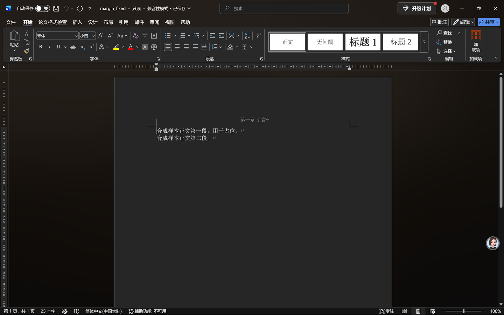
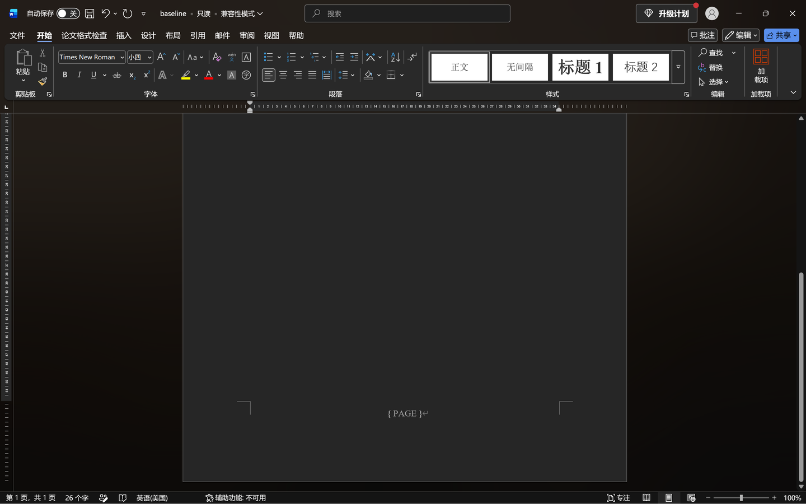
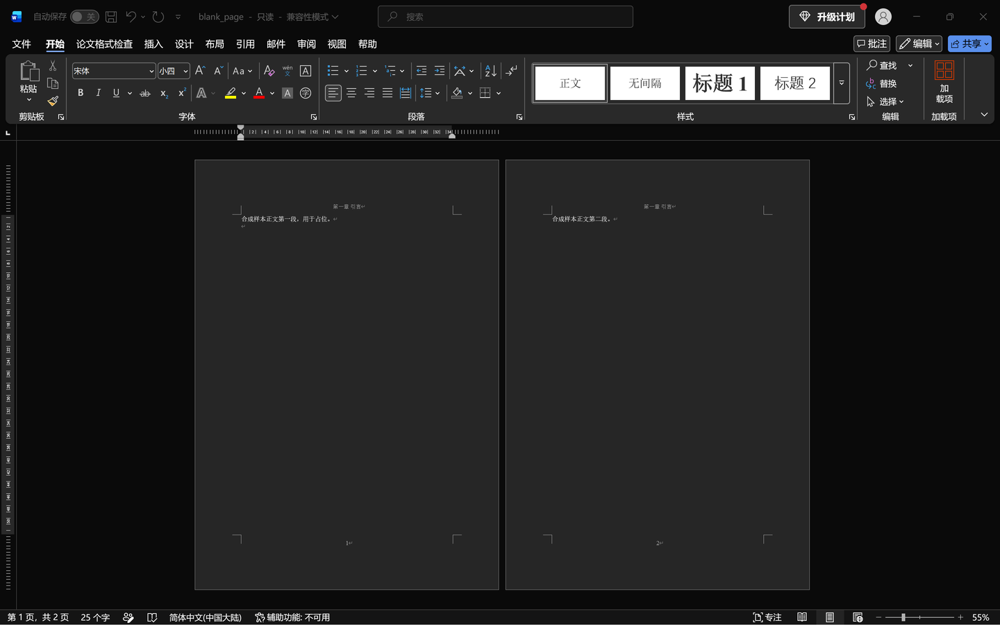
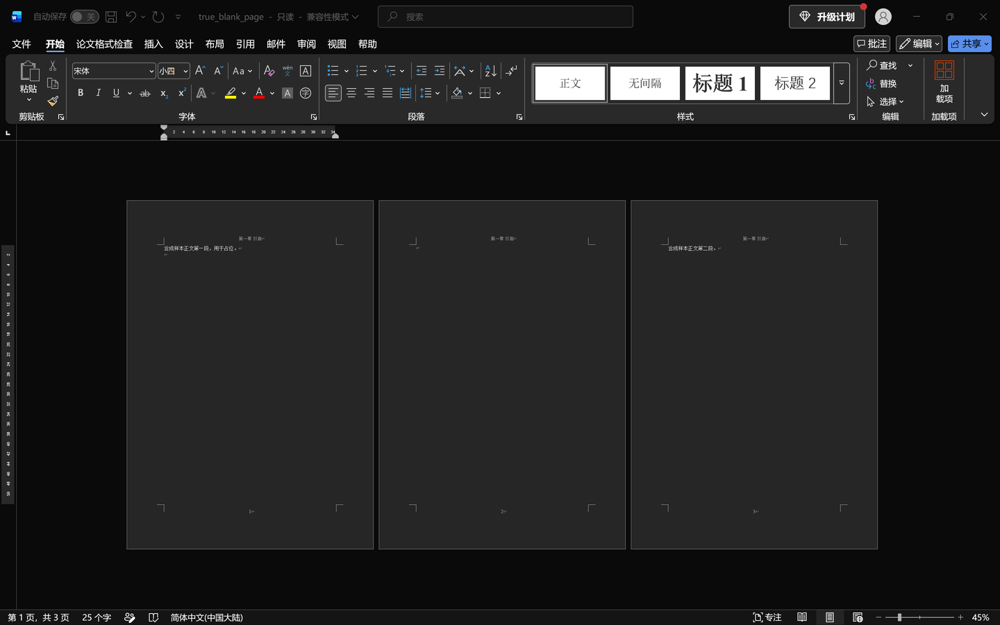

# 文档级检查：Word 16 实机核验记录（Issue #112）

核验日期：2026-11-10。环境：Windows，Microsoft Word 16.0，通过 COM 自动化**只读打开**文档，
用对象模型读回 Word 自己算出来的值，再用屏幕截图留证。样本全部是 `generate.py` 生成的合成文档，
不含真实论文或个人信息。

写这份记录的原因：XML 里写了 `pgMar/@top="2154"` 只能说明文件里是这个数，不能说明 Word 认这个数、
也不能说明打开之后版式没变。检查器和修复器都要拿 Word 的实际读数对一遍。

## 一、页边距与纸张（R1）

对象：`artifacts/word-verify/margin_fixed.docx`，由 `apply-document-format` 修复
`document_margin_wrong.docx`（原本上下 2.5cm）得到。

`PageSetup` 读回，单位由磅换算成 cm（1cm = 28.3464567 pt）：

| 项 | R1 规定 | Word 读回 | 结论 |
| --- | --- | --- | --- |
| 上边距 | 3.8 cm | 3.799 cm | 一致 |
| 下边距 | 3.8 cm | 3.799 cm | 一致 |
| 左边距 | 3.2 cm | 3.2 cm | 一致 |
| 右边距 | 3.2 cm | 3.2 cm | 一致 |
| 页眉距边界 | 3.0 cm | 3.0 cm | 一致 |
| 页脚距边界 | 3.0 cm | 3.0 cm | 一致 |
| 装订线 | 0 cm | 0 cm | 一致 |
| 纸张 | A4 21.0 × 29.7 cm | 21.001 × 29.7 cm | 一致 |

3.799 与 21.001 是 twips 取整带来的差：3.8cm 按 1440/2.54 换算是 2154 twips，
Word 再换算回 cm 就成了 3.799。检查器的 0.1cm 容差就是为这类取整准备的，不是把错误放过去。



修复前后用 Word 各读一次 `Content.Text`，逐字比对：

```
原始：合成样本正文第一段，用于占位。|合成样本正文第二段。|
修复：合成样本正文第一段，用于占位。|合成样本正文第二段。|
正文逐字相同：True  字符数 27 / 27
```

（`|` 是段落标记 `\r` 的替代显示。）这一条对应验收第 4 条「跑完用 Word 打开内容无变化」。

## 二、页码（R3）

对象：`document_baseline_correct.docx`。

| 项 | R3 规定 | Word 读回 | 结论 |
| --- | --- | --- | --- |
| 是不是真域 | PAGE 域 | `Field.Type = 33`（wdFieldPage）、`Field.Code = PAGE` | 是 |
| 显示值 | 当前页码 | `Field.Result.Text = 1` | 一致 |
| 中文字体 | 宋体 10.5 磅 | `Result.Font.NameFarEast = 宋体`、`Size = 10.5` | 一致 |
| 西文字体 | 规范未规定 | `Result.Font.Name = Times New Roman` | 不判 |
| 对齐 | 居中 | `Paragraphs(1).Format.Alignment = 1`（wdAlignParagraphCenter） | 一致 |

有个坑记在这里：读**整个页脚段落**的 `Range.Font.Size` 会得到 `9999999`（wdUndefined），
因为页脚里 `fldChar` / `instrText` 那几个 run 没有字体属性，混在一起 Word 给不出单一值。
必须读 `Field.Result.Font`，也就是域的显示结果那个 run。检查器只判带 `w:t` 的 run、
跳过域控制 run，正是这个原因。



截图里打开的是「显示域代码」，页脚中间是 `{ PAGE }`，比一个数字更能说明它真是域而不是手打的 1。

## 三、空白页（无条款，惯例项）

这一项在实机上把第一档的判定口径修正了。

**单个空段落带分页符**（`document_blank_page.docx`）：Word 实际 2 页，
第 1 页有正文第一段 + 空段落，第 2 页有正文第二段。**没有整页空白**，只是多了一页。



**连续两个空段落各带一个分页符**（本档新增 `document_true_blank_page.docx`）：Word 实际 3 页，
用 `Selection.Bookmarks("\Page").Range.Text` 逐页读回：

| 页 | 正文读回 | 长度 |
| --- | --- | --- |
| 1 | `合成样本正文第一段，用于占位。\|^` | 18 |
| 2 | `^\|`（只有分页标记，无正文） | 2 |
| 3 | `合成样本正文第二段。` | 10 |

（`^` 是换页符 `\f` 的替代显示。）第 2 页确实整页没有正文。



所以 D10 现在分两种报法，措辞不混用：

- 单个空段落带分页符 → 「疑似空白页」，并在 `当前` 里写明「Word 实测只会多一页，第二页仍有正文，不等于整页空白」；
- 连续空段落各带分页符 → 「连续分页符造成整页空白」，给出删多余空段落的操作。

两种都是惯例提示，`Basis` 以「排版惯例」开头，不计入规范符合性。规范里没有空白页条款，
这一点不因为实机能验就变成规范项。

## 四、没验到的

- 页眉字体字号（D11）没有单独截图。检查器读的是 XML 样式链，Word 读回整个页眉 Range 同样会遇到
  混合字体的问题；这一项靠 26 份合成样本的正负对照覆盖，没有拿 Word 单独留证。
- 目录 TOC 域、奇偶页不同、页码前置部分罗马数字：这些要在真实多节论文里才验得准，合成样本验了也说明不了什么。
- 段后间距、表格跨页导致的空白页：要真实分页才判得准，XML 层面算不出来，报告里列在「未检查」。
- 截图里 Word 是深色主题，页面底色偏黑，这是本机 Office 主题设置，不是文档内容。

## 五、复现方式

样本由 `tests/fixtures/synthetic/document/generate.py` 生成，`python generate.py --check` 可逐字节核对。
修复件用 `apply-document-format <输入> <输出>` 得到。COM 读数脚本用的是 PowerShell 的
`[Runtime.InteropServices.Marshal]::GetActiveObject('Word.Application')`，逐项读 `PageSetup`、
`Field.Result`、`ComputeStatistics(wdStatisticPages)` 和 `\Page` 书签范围；
截图是屏幕截取，没有对图像做拼接或内容修改，只做了 2x DPI 到逻辑像素的等比例缩小。
